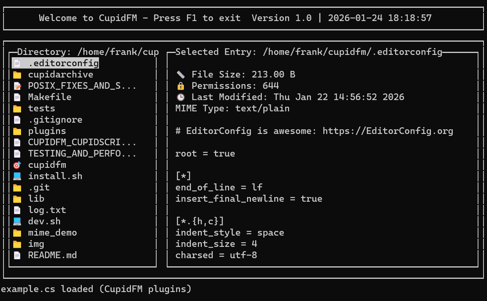

# CupidFM

CupidFM is a terminal file manager written in C with an ncurses interface. It includes directory navigation, previews, a text editor, Git status indicators, and CupidScript plugins.



## Build and run

On Ubuntu or Debian:

```sh
sudo apt install build-essential libncurses-dev libmagic-dev libssl-dev openssl \
    zlib1g-dev libbz2-dev liblzma-dev xclip python3
make -j
./cupidfm
```

The default build uses `-O2 -g`. Libraries are built from pinned source folders under `lib/`. See [Installation](https://github.com/cupidthecat/cupidfm/wiki/Installation) for other package managers, sanitizer builds, and terminal setup.

```sh
./cupidfm ~/Documents
./cupidfm -- ./-directory
./cupidfm --help
```

With the default configuration, arrows navigate, Tab switches panes, F1 exits, and Ctrl+E opens the editor. Settings are stored in `~/.cupidfmrc`; plugins load from `~/.cupidfm/plugins/`.

## Features

- Directory browsing, search, file operations, and an editor.
- Text previews with syntax highlighting and bounded line indexing.
- Image rendering through Kitty graphics, Sixel, or ANSI modes supported by the terminal.
- TAR, ZIP, compressed-file, and multi-file/solid 7z previews through CupidArchive.
- Git working-tree status compared with the index through CupidGit.
- CupidScript plugins with file manager and editor APIs.

Scrolling preserves queued keys and reuses validated MIME results. See [the performance notes](PERFORMANCE.md) for measured workloads, benchmark commands, and limits.

## Documentation

- [Wiki home](https://github.com/cupidthecat/cupidfm/wiki).
- [Quick start](https://github.com/cupidthecat/cupidfm/wiki/Quick-Start-Guide), [configuration](https://github.com/cupidthecat/cupidfm/wiki/Configuration-Guide), and [shortcuts](https://github.com/cupidthecat/cupidfm/wiki/Keyboard-Shortcuts).
- [Full reference and roadmap](https://github.com/cupidthecat/cupidfm/wiki/Reference), also kept in [docs/user-guide.md](docs/user-guide.md).
- [Plugin wiki](https://github.com/cupidthecat/cupidfm/wiki/Plugin-System) and [source API guide](CUPIDFM_CUPIDSCRIPT_API.md).
- [File operation safety](https://github.com/cupidthecat/cupidfm/wiki/File-Operation-Safety).
- [Library sources](lib/README.md), [source pins](lib/sources.json), and [contributor notes](docs/development.md).

## Tests

After building the application:

```sh
make test
make test-libs
python3 tests/test_terminal_smoke.py
python3 tests/test_scroll_smoke.py
```

`./dev.sh` builds with AddressSanitizer and UndefinedBehaviorSanitizer and prompts before launching. Hosted checks also run focused allocation, input, MIME, preview, and terminal regressions.

Licensed under [GPL-3.0](LICENSE).
